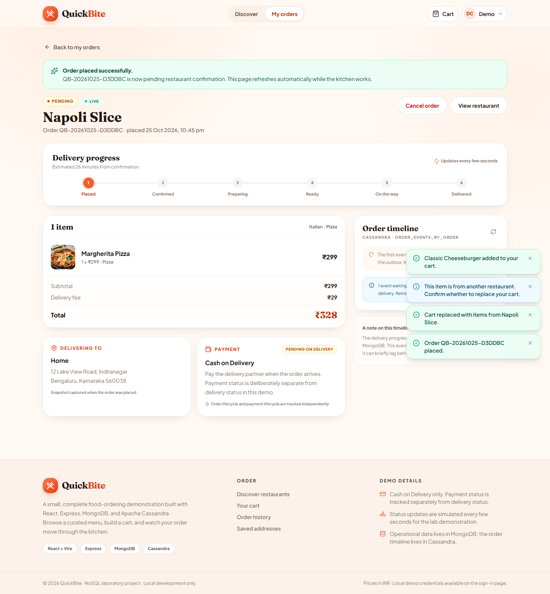
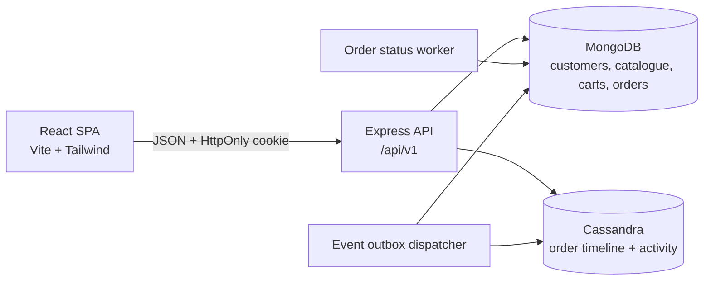

# QuickBite

A complete customer-facing online food ordering and delivery demo built for a NoSQL laboratory project. QuickBite combines a polished React storefront with an Express API, MongoDB for operational data, and Apache Cassandra for append-only order history.

The app is deliberately scoped: one interactive role (customer), Cash on Delivery only, no admin/restaurant/delivery dashboards, no payment gateway, no image uploads, and no real-time sockets. Order progression is simulated by a persisted background worker so the full lifecycle can be demonstrated in under a minute.



## What it demonstrates

- **React 19 + Vite + Tailwind CSS 4** storefront with warm orange/cream styling, desktop-first layout, and mobile-safe responsive behaviour.
- **Persistent MongoDB cart** with one restaurant per cart, explicit replacement confirmation, and a hard cap of 10 units per dish.
- **Server-authoritative checkout**: current menu prices, availability and opening hours are re-read and validated at order time.
- **Immutable order snapshots** for items, restaurant details and delivery address, so later catalogue or profile edits never rewrite history.
- **Simulated six-stage delivery lifecycle** persisted in MongoDB and advanced by a background worker (`PENDING → CONFIRMED → PREPARING → READY_FOR_PICKUP → OUT_FOR_DELIVERY → DELIVERED`).
- **Atomic cancellation** from `PENDING` only, using a conditional single-document update.
- **MongoDB event outbox** delivered to Cassandra with stable event IDs, retries and capped exponential backoff.
- **Two Cassandra access patterns**: an order timeline and a customer activity feed, both idempotent and display-ready.
- **Timezone-aware restaurant availability**, including cross-midnight hours, with closed kitchens still browsable but not orderable.
- **JWT in an HttpOnly cookie**, bcrypt password hashing, token-version session invalidation, origin checks, rate limits and Zod validation.
- **41 backend integration tests**, a production frontend build, a repeatable seed, and a one-command development startup.

## Tech stack

| Layer | Technology |
| --- | --- |
| Frontend | React 19, Vite 8, React Router 7, Tailwind CSS 4, lucide-react |
| Backend | Node.js 20.19+, Express 4, Zod 4, Mongoose 8 |
| Operational database | MongoDB 7.0 |
| Event history | Apache Cassandra 5.0 (`cassandra-driver` 4) |
| Auth | JWT (`jsonwebtoken`), bcrypt (`bcryptjs`), HttpOnly cookie |
| Tests | Vitest 5 + Supertest 7 |
| Infrastructure | Docker Compose, npm workspaces |

## Architecture at a glance



MongoDB is the source of truth. Cassandra is a derived, append-only history store. New order events are written into an array on the order document in the same MongoDB update as the order state change, then an outbox worker copies them to Cassandra. See [docs/ARCHITECTURE.md](docs/ARCHITECTURE.md) for sequence diagrams and design reasoning.

## Quick start

### Prerequisites

- Node.js **20.19 or newer** and npm
- Docker Desktop (or Docker Engine + Compose v2), with the daemon running
- Free local ports: `5173` (frontend), `4000` (API), `27017` (MongoDB), `9042` (Cassandra)
- Internet access for the seeded Unsplash food images (the UI has a graceful fallback if images cannot load)

### Run everything with one command

```bash
npm install
npm run dev
```

`npm run dev` is idempotent and will:

1. Copy `.env.example` to `.env` if no local environment file exists.
2. Start MongoDB and Cassandra with Docker Compose.
3. Wait for both databases to become usable (Cassandra can take a minute on first run).
4. Create MongoDB indexes and the Cassandra keyspace/tables without deleting anything.
5. Seed the demo catalogue, demo customer and saved Home address (because `AUTO_SEED=true`).
6. Start the Express API and the Vite dev server.

Open:

| Service | URL |
| --- | --- |
| Storefront | <http://localhost:5173> |
| API | <http://localhost:4000> |
| Liveness | <http://localhost:4000/health> |
| Readiness | <http://localhost:4000/ready> |

### Demo credentials (local development only)

```text
Email:    demo@quickbite.local
Password: Demo@123
```

The demo account includes a saved **Home** address so checkout can be completed immediately.

> If the seeded demo password was changed through the profile screen, run `npm run seed` to restore the configured demo credentials.

## Project structure

```text
.
├── backend/
│   ├── src/
│   │   ├── config/          # Validated environment configuration
│   │   ├── constants/       # Order statuses, payment and event constants
│   │   ├── controllers/     # HTTP request/response adapters
│   │   ├── database/        # MongoDB and Cassandra connections/schema
│   │   ├── middleware/      # Auth, validation, errors, rate limits, origin guard
│   │   ├── models/          # Mongoose schemas and indexes
│   │   ├── routes/          # /api/v1 route definitions
│   │   ├── scripts/         # Database init and idempotent seed
│   │   ├── services/        # Business logic, workers, outbox
│   │   ├── utils/           # Time, money, IDs, logging, serializers
│   │   ├── app.js           # Express app assembly
│   │   └── server.js        # Startup, workers, graceful shutdown
│   └── tests/               # 41 Vitest + Supertest integration tests
├── database/seed/           # Curated demo catalogue and demo customer
├── docs/                    # Architecture, database, API, setup and demo docs
├── frontend/
│   └── src/
│       ├── components/      # Shared UI, dialogs, steppers, cards
│       ├── context/         # Auth, cart and toast contexts
│       ├── hooks/           # Add-to-cart and page-title helpers
│       ├── pages/           # Home, restaurant, food, cart, checkout, orders, profile
│       ├── services/        # Fetch wrapper and API error mapping
│       └── utils/           # INR and date formatting
├── scripts/
│   ├── dev.mjs              # One-command local startup
│   ├── verify.mjs           # Tests + production build verification
│   └── lib/infra.mjs        # Compose, readiness and process helpers
├── docker-compose.yml       # MongoDB 7.0 + Cassandra 5.0 with named volumes
├── .env.example             # Local-only configuration template
└── package.json             # npm workspaces and root scripts
```

## Available commands

| Command | Purpose |
| --- | --- |
| `npm run dev` | Start databases, initialize/seed, API and frontend together |
| `npm run db:up` | Start MongoDB and Cassandra only |
| `npm run db:down` | Stop containers; named volumes are kept |
| `npm run db:logs` | Follow container logs |
| `npm run init:db` | Ensure MongoDB indexes and Cassandra schema exist |
| `npm run seed` | Upsert demo catalogue/customer/address (safe to repeat) |
| `npm run backend` | Run only the API with Node watch mode |
| `npm run frontend` | Run only the Vite dev server |
| `npm test` | Run the backend integration suite against test databases |
| `npm run test:watch` | Run backend tests in watch mode |
| `npm run build` | Build the production frontend bundle into `frontend/dist` |
| `npm run verify` | Start dependencies, run all tests and build the frontend |

> `npm test` and `npm run verify` use `quickbite_test` for both MongoDB and Cassandra, so they do not mutate the development data.

## Data model summary

MongoDB collections: `customers`, `restaurants`, `food_items`, `carts`, `addresses`, `orders`.

Cassandra tables, both keyed for a specific query pattern:

- `order_events_by_order` — every event for one order, oldest first.
- `customer_order_activity_by_customer` — a customer's recent activity, newest first.

Money is stored and transported as **integer paise** (`₹249.00 = 24900`). UI formatting is the only place where rupees are shown. Order status and payment status are separate fields; because this demo only supports Cash on Delivery and never collects payment, `paymentStatus` remains `PENDING` even after delivery.

Full schema, indexes, CQL and rationale: [docs/DATABASE_DESIGN.md](docs/DATABASE_DESIGN.md).

## API summary

All application endpoints live under `/api/v1`. Successful responses use `{ "data": ... }`; failures use:

```json
{
  "error": {
    "code": "CART_RESTAURANT_CONFLICT",
    "message": "Your cart contains food from another restaurant. Confirm before replacing it.",
    "details": []
  }
}
```

Authentication uses the `quickbite_token` cookie. See [docs/API.md](docs/API.md) for every endpoint, request body, response shape and error code.

## Verification performed

Verified locally on **25 October 2026** (Windows, Docker Desktop, Node 20+):

- `npm test` — **41/41 backend tests passing**, covering auth, catalogue, cart concurrency rules, checkout snapshots, cancellation, full lifecycle, ownership, outbox delivery/retries/idempotence, availability and system endpoints.
- `npm run build` — **production frontend build completed** (`frontend/dist`).
- `npm run seed` — repeated successfully; upserts by stable keys without duplicating restaurants, dishes, customer or address.
- Live browser flow via Playwright/Chrome — **25/25 checks passed**, including demo login, search, cart replacement dialog, checkout, order creation, cancellation, Cassandra timeline rendering, activity feed, closed-restaurant behaviour, sign-out and mobile overflow.
- Live API flow — **55/55 checks passed**, including cookie auth, persistence, quantity caps, checkout validation, immutable snapshots, full six-stage lifecycle and both Cassandra tables.

Screenshots from that run are in [docs/images](docs/images).

## Documentation

- [Architecture](docs/ARCHITECTURE.md) — components, request flows, workers, outbox and design trade-offs.
- [Database design](docs/DATABASE_DESIGN.md) — MongoDB schemas/indexes and Cassandra table design.
- [API reference](docs/API.md) — endpoints, payloads, status codes and error codes.
- [Setup guide](docs/SETUP.md) — prerequisites, environment variables, manual startup and reset procedures.
- [Demo guide](docs/DEMO_GUIDE.md) — a timed walkthrough for presenting the project.
- [Troubleshooting](docs/TROUBLESHOOTING.md) — common local issues and fixes.
- [Project requirements and plan](PRP.md) — scope, requirements, acceptance criteria and risks.

## Scope and known limitations

This is a local, educational demo. It intentionally omits admin/restaurant/delivery dashboards, reviews, payment gateways, image uploads, GPS tracking and WebSocket updates.

- The lifecycle is simulated every 12 seconds and is not a real kitchen/delivery workflow.
- Cash on Delivery is the only payment method; no money is collected.
- Rate limiting is in-memory, which is appropriate for a single local API instance.
- Cassandra uses `SimpleStrategy` with replication factor 1 for local Docker; production would use a proper network topology strategy and multiple nodes.
- Search is a bounded case-insensitive substring search over the small seeded catalogue.
- The demo contains one deliberately closed kitchen (`Sugar & Spice`, open 03:00–03:15 IST) and two deliberately unavailable dishes for testing.
- Unsplash images need network access; a fallback is rendered if they fail.
- There is no Git repository in this workspace; no commits are included.

## Shutdown

Press `Ctrl+C` in the `npm run dev` terminal. The frontend and API stop, but MongoDB and Cassandra containers **and their volumes stay intact**.

```bash
npm run db:down
```

To remove the local database data as well (destructive), run:

```bash
docker compose down -v
```

## Educational note

QuickBite is a laboratory/demo project, not a production service. The credentials, JWT secret and database passwords in `.env.example` are local-only values and must never be reused in production.
