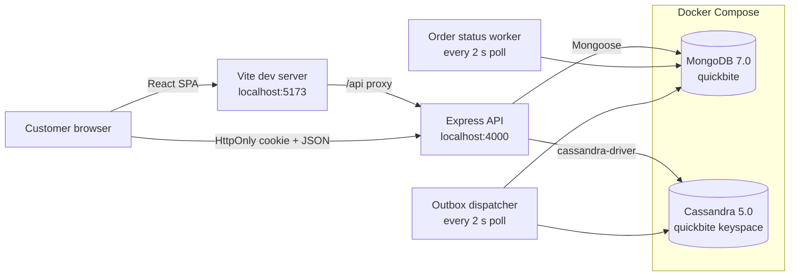
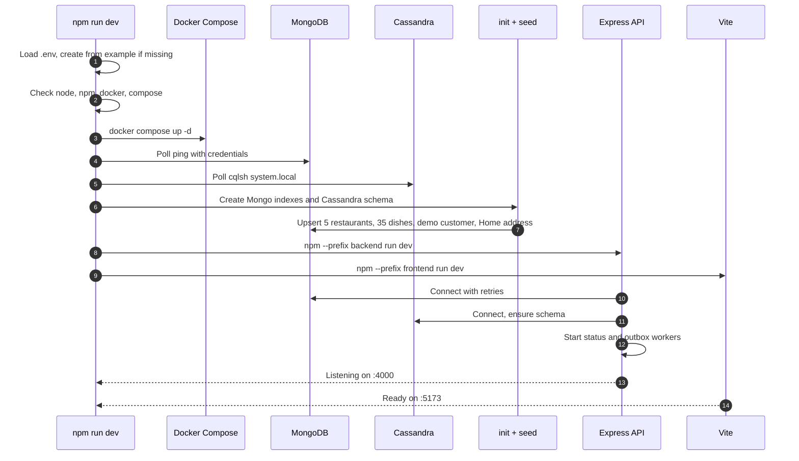
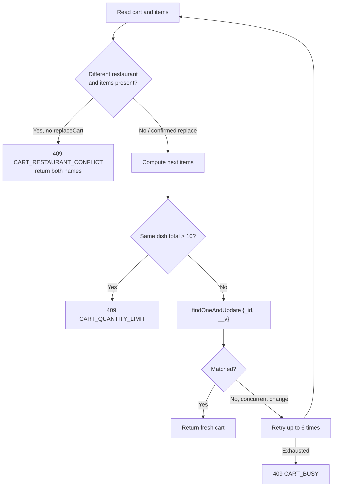
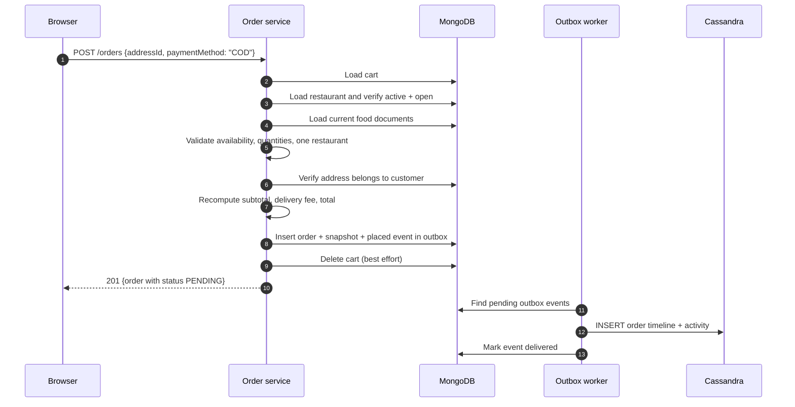
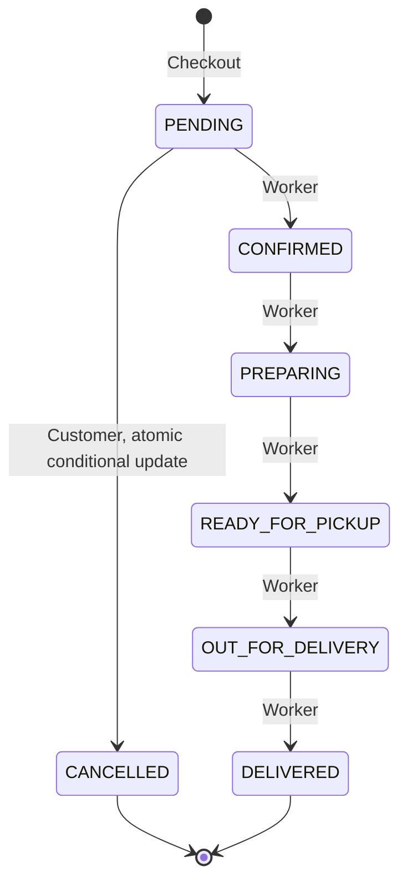
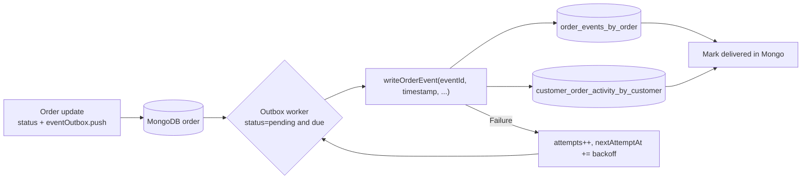
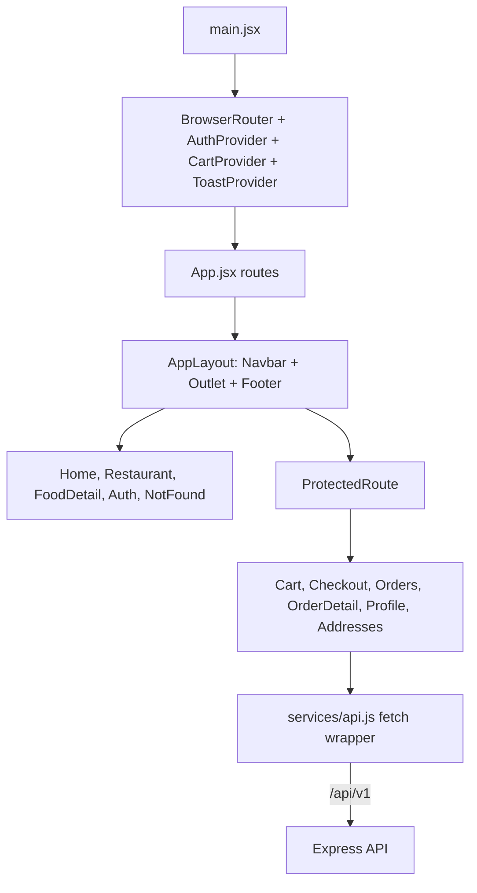

# QuickBite Architecture

## 1. Architectural goals

QuickBite is a two-database full-stack demo. The architecture optimizes for:

- **Correctness under concurrency** without requiring a MongoDB replica set.
- **Clear ownership of data**: MongoDB for current state, Cassandra for immutable history.
- **An honest UI**: server-authoritative totals, visible disabled states, and no optimistic fiction about payment.
- **A repeatable local demo**: one command, safe seed, isolated tests, no external services beyond Docker and image CDNs.
- **Explainable NoSQL choices**: each Cassandra table exists because of a concrete query pattern.

## 2. System context



MongoDB and Cassandra run in Docker with named volumes (`quickbite-mongo-data`, `quickbite-cassandra-data`). The API and Vite server run as local Node processes. In development, Vite proxies `/api` to `http://127.0.0.1:4000`, so the browser only talks to port 5173 and cookies stay same-origin.

## 3. Backend layering

| Layer | Responsibility | Examples |
| --- | --- | --- |
| Routes | URL, method, guard, validation wiring | `order.routes.js` |
| Middleware | Auth, origin guard, Zod validation, rate limits, error mapping | `auth.js`, `origin-guard.js`, `validate.js`, `error.js` |
| Controllers | Translate HTTP to service calls and responses | `order.controller.js` |
| Services | Business rules, concurrency, transactions-by-update, workers | `order.service.js`, `cart.service.js` |
| Models | Schemas, enums, indexes | `Order.js`, `Cart.js` |
| Database | Connections, readiness, CQL, schema creation | `mongodb.js`, `cassandra.js`, `cassandra-schema.js` |
| Utilities | Time, serialization, money, IDs, logging, API errors | `time.js`, `serializers.js`, `api-error.js` |

The API exposes a consistent success envelope `{ data: ... }` and error envelope `{ error: { code, message, details } }`. Controllers do not leak Mongoose documents; serializers control field names and hide internals such as `passwordHash` and `eventOutbox`.

## 4. Startup sequence



Initialization never drops data. The seed upserts by stable keys (restaurant slug, dish name per restaurant, customer email, address label + line 1), so restarts and repeated `npm run seed` calls are safe.

## 5. Authentication and session flow

```mermaid
sequenceDiagram
  autonumber
  participant Browser
  participant API as Express API
  participant Mongo as MongoDB

  Browser->>API: POST /api/v1/auth/login {email, password}
  API->>Mongo: Find customer by email
  API->>API: bcrypt.compare(password, hash)
  API->>API: Sign JWT {sub, role, ver}
  API-->>Browser: 200 + Set-Cookie quickbite_token=...; HttpOnly; SameSite=Lax
  Browser->>API: GET /api/v1/cart (cookie sent automatically)
  API->>API: Verify signature, role, expiry
  API->>Mongo: Load customer by sub
  API->>API: Compare JWT ver with customer.tokenVersion
  API-->>Browser: 200 {cart}
```

Key decisions:

- The token is never readable by JavaScript, reducing XSS token theft.
- `tokenVersion` invalidates every prior token after a password change.
- `SameSite=Lax` prevents most cross-site cookie sending; the origin guard additionally rejects state-changing requests whose `Origin`/`Referer` is not the configured frontend.
- Requests without `Origin`/`Referer` (curl, server-to-server, tests) are allowed but cannot ride a victim's browser cookie.
- Rate limits apply to login/register and sensitive profile actions. The current limiter is in-memory and appropriate for one local API instance.

## 6. Catalogue and availability

Availability is computed on read, not stored as a mutable boolean:

1. Read `openingTime`, `closingTime` and `timezone` from the restaurant document.
2. Format "now" in that IANA timezone with `Intl.DateTimeFormat`.
3. Convert local hours/minutes to minutes since midnight.
4. Compare:
   - `open < close`: open when `local >= open && local < close`.
   - `open > close`: cross-midnight, open when `local >= open || local < close`.
   - `open === close`: documented 24-hour period.
5. Fail closed for inactive restaurants, invalid clocks or invalid timezones.

This avoids cron jobs and makes daylight-saving/timezone changes automatic for the configured zone. In this demo all restaurants use `Asia/Kolkata`.

Closed restaurants are still returned and browsable. The API blocks adding items with `RESTAURANT_CLOSED`, and the UI disables Add buttons with an explanatory notice.

## 7. Cart consistency

Each customer has exactly one cart enforced by a unique index. Writes follow:



Prices are never stored in the cart. `getCartResponse` joins current food documents and computes line totals, subtotal, delivery fee and total. If a dish disappears or becomes unavailable, the cart remains but `canCheckout` becomes false with blocking reasons and the UI offers removal.

## 8. Checkout flow



The order insert and the outbox intent are a single atomic MongoDB document insert. There is no multi-document transaction requirement. If cart deletion fails after the order is created, the order is kept (the authoritative outcome) and the stale cart can be cleared manually; the failure is logged.

Checkout failures preserve the cart:

- `EMPTY_CART` (400)
- `INVALID_DELIVERY_ADDRESS` (400)
- `UNSUPPORTED_PAYMENT_METHOD` (400)
- `RESTAURANT_CLOSED` (409)
- `RESTAURANT_UNAVAILABLE` (409)
- `CART_ITEMS_UNAVAILABLE` (409 with per-item details)
- `INVALID_CART` (409 if items span restaurants, which should not occur)

## 9. Order lifecycle and cancellation



The worker:

- Polls every 2 seconds for orders whose `nextStatusAt <= now`.
- Sorts by `nextStatusAt` and takes a bounded batch.
- Computes the next status from a fixed map.
- Performs `findOneAndUpdate` filtered by `_id`, expected `status`, and due `nextStatusAt`.
- Pushes the event into the embedded outbox in the same update.
- Sets `nextStatusAt` to the next planned time, or `null` on delivery.
- Uses the planned transition time to keep event timestamps stable even if polling is delayed.

The conditional filter is the concurrency control. If a customer cancels first, the worker update matches nothing. If the worker advances first, the cancellation update matches nothing and returns `409 ORDER_CANNOT_CANCEL`.

## 10. Outbox and Cassandra delivery



Why an embedded outbox:

- It avoids dual writes across MongoDB and Cassandra in the request path.
- It makes the state change and event intent atomic in one document.
- It tolerates Cassandra being down without failing checkout.
- It preserves events indefinitely; retries slow to the configured maximum but never discard.

Idempotence:

- `eventId` is a UUID generated once when the event is created.
- `eventTimestamp` is also stable.
- Both Cassandra tables use `INSERT`, which behaves as an upsert for the same primary key.
- A retry after a partial success rewrites both rows with identical values, producing no duplicates.
- The Mongo delivery marker update is guarded by `eventId` and `status: pending`.

Backoff:

```text
delay = min(OUTBOX_BASE_DELAY_MS * 2^(attempts - 1), OUTBOX_MAX_DELAY_MS)
```

Defaults: base 2 s, maximum 120 s, poll every 2 s, batch 20 orders.

The UI shows `pendingEvents` from the order's outbox. While it is greater than zero, the order detail page refreshes the timeline every 3 seconds. This closes the gap where a slow retry lands after the terminal-status refresh.

## 11. Frontend architecture



State ownership:

- **AuthContext** owns the current customer, login/register/logout, profile updates, and reacts to unauthorized responses.
- **CartContext** owns the persistent cart, optimistic-conflict modal state, quantity changes and clearing.
- **ToastContext** owns transient success/error messages.
- Pages own their own loading/error/data state with abortable fetches.
- `useAddToCart` centralizes the guest redirect and the restaurant-conflict flow so every Add button behaves consistently.

Routing:

| Path | Access | Purpose |
| --- | --- | --- |
| `/` | Public | Discovery, search, categories |
| `/restaurants/:id` | Public | Restaurant menu |
| `/food/:id` | Public | Dish detail |
| `/auth` | Public | Login/register |
| `/cart` | Customer | Persistent cart |
| `/checkout` | Customer | Address + COD + place order |
| `/orders` | Customer | Order history + Cassandra activity |
| `/orders/:id` | Customer | Status, timeline, cancel, polling |
| `/profile` | Customer | Profile and password |
| `/addresses` | Customer | Address CRUD |
| `*` | Public | Not found |

Unknown paths render the 404 page. Auth guards are path-scoped, so a request to an unknown path is not intercepted as an auth failure.

## 12. Data consistency model

| Data | Store | Authority | Consistency |
| --- | --- | --- | --- |
| Customers, addresses | MongoDB | Strong | Single-document updates |
| Restaurants, dishes | MongoDB | Strong | Seed/admin-free; read at request time |
| Cart | MongoDB | Strong | Compare-and-swap on `__v` |
| Orders and status | MongoDB | Strong | Conditional single-document updates |
| Outbox state | MongoDB (embedded) | Strong | Same write as status |
| Order timeline | Cassandra | Eventual derived copy | Idempotent upsert, retried |
| Customer activity | Cassandra | Eventual derived copy | Idempotent upsert, retried |

If Cassandra is unavailable:

- Checkout still succeeds; the order and outbox event are durable in MongoDB.
- Timeline/activity endpoints return `503` with a temporary-unavailable code.
- The outbox retries automatically.
- The UI remains usable and explains that events are waiting.

If MongoDB is unavailable:

- `/health` still reports liveness.
- `/ready` reports not ready.
- Business endpoints fail; the API does not pretend to accept orders.

## 13. Security model

- **Passwords:** bcrypt hashes, `select: false` on the hash field.
- **Sessions:** JWT in HttpOnly cookie; token version check on every authenticated request.
- **CSRF:** SameSite=Lax plus origin/referer validation for unsafe methods.
- **Authorization:** Every cart, address and order query is scoped by `customerId`; foreign order IDs return 404.
- **Validation:** Zod schemas for bodies, params and query; ObjectId format checked before Mongoose.
- **Errors:** Internal errors and stack traces are not sent to clients; consistent error envelopes.
- **Headers:** Helmet sets baseline security headers; `x-powered-by` is disabled.
- **Rate limits:** Login/register 30 per 15 minutes; password change 20 per 10 minutes (skipped in tests).
- **Body limits:** JSON limited to 100 KB.
- **Production checks:** Placeholder JWT secrets, insecure cookies and SameSite=None without Secure are rejected at startup.

## 14. Failure handling

| Failure | Behaviour |
| --- | --- |
| MongoDB connection lost | Mongoose buffers/reconnects; workers log and retry; readiness reports down. |
| Cassandra connection lost | `ensureClient` reconnects on demand; outbox retries; timeline reads return 503. |
| Worker overlap | In-process running guard plus conditional updates prevent double transitions. |
| Duplicate order number | Unique index triggers a bounded retry with a new random suffix. |
| Concurrent cart update | Version mismatch triggers a bounded retry, then `CART_BUSY`. |
| Duplicate registration | Unique email index returns `EMAIL_ALREADY_REGISTERED`. |
| Docker daemon stops | Containers and app lose databases; restart Docker and wait for reconnection or restart `npm run dev`. |

## 15. Trade-offs and future work

- **Cassandra RF1 / SimpleStrategy** is appropriate only for local Docker. Production needs multiple nodes and NetworkTopologyStrategy.
- **In-memory rate limits** do not coordinate across processes. A shared store would be needed if the API scaled out.
- **Workers inside the API process** simplify the demo but would need leader election or a separate worker deployment at scale.
- **No event archival.** Mongo outbox entries are retained for audit; a production system would archive delivered entries.
- **Regex search** is bounded to the seeded catalogue; a text index or search service would replace it at scale.
- **Single currency and no tax engine.** Integer paise keeps the demo precise but does not model tax jurisdictions.
- **No real payment or refunds.** COD and `paymentStatus: PENDING` are deliberately honest.
- **Polling instead of push.** The order page polls every 4 seconds while active and every 3 seconds while outbox events are pending.
