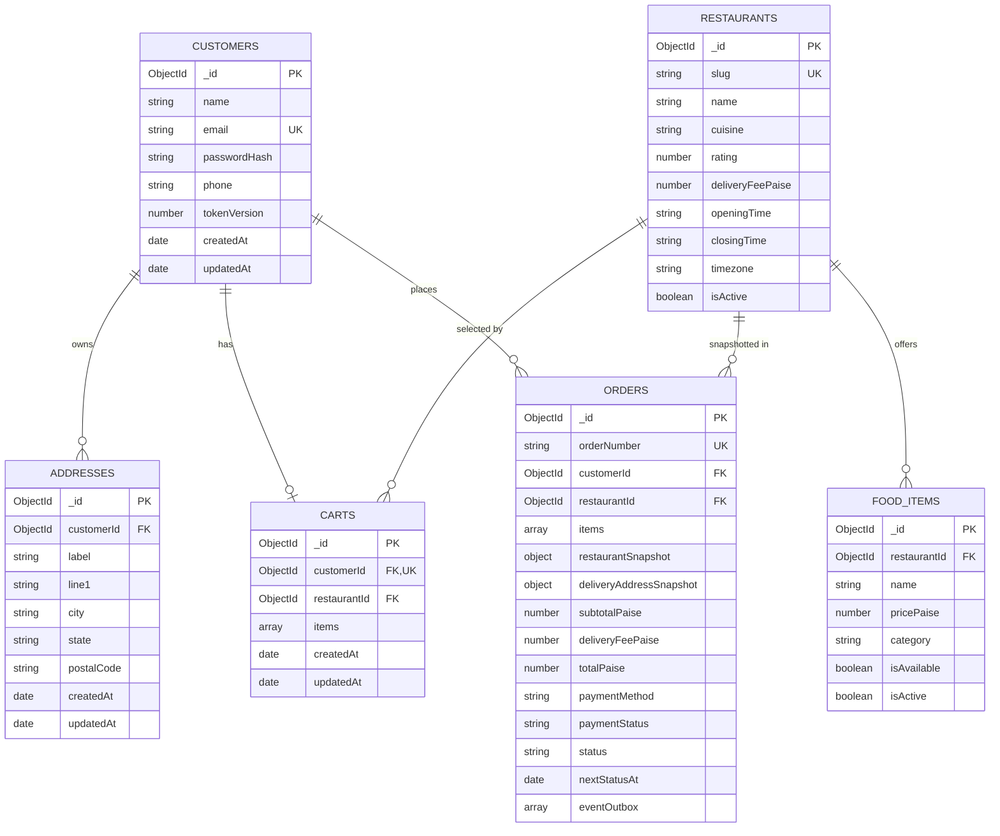
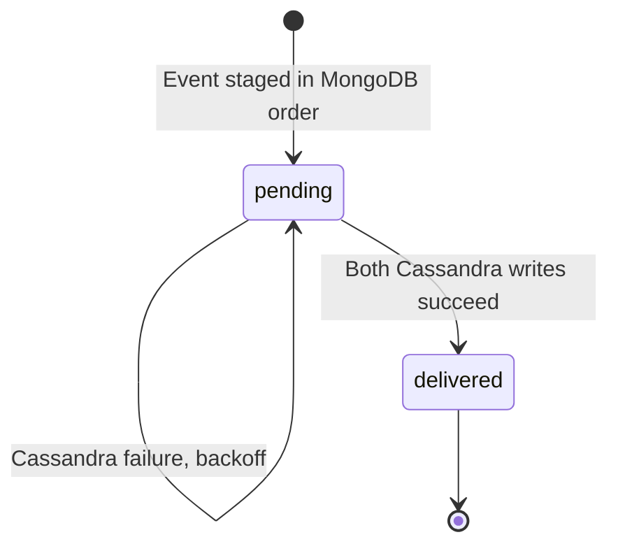

# QuickBite Database Design

QuickBite uses two databases for two different jobs:

- **MongoDB** stores current, mutable operational data. It is the source of truth.
- **Apache Cassandra** stores append-only event history in query-specific tables.

This document describes both schemas, why they look the way they do, and how data moves between them.

## 1. MongoDB overview

Database name: `quickbite` (configurable through `MONGODB_DB_NAME`).

Collections:

| Collection | Purpose |
| --- | --- |
| `customers` | Accounts, password hashes, session invalidation version |
| `restaurants` | Restaurant identity, hours, timezone, fee, rating |
| `food_items` | Menu dishes, prices, availability |
| `carts` | One persistent cart per customer |
| `addresses` | Saved delivery addresses |
| `orders` | Authoritative orders, snapshots, status and embedded outbox |

### Entity relationships



Mongoose stores `ObjectId` references; there are no database-level foreign keys. Ownership and referential integrity are enforced in services. For example, checkout requires `Address.findOne({ _id: addressId, customerId })`, and every order read is scoped by `customerId`.

## 2. Collection details

### 2.1 `customers`

| Field | Type | Notes |
| --- | --- | --- |
| `_id` | ObjectId | Primary key |
| `name` | String | 2–80 chars, trimmed |
| `email` | String | Unique, lowercase, trimmed, max 254 |
| `passwordHash` | String | bcrypt hash, `select: false` |
| `phone` | String | Optional, max 20 |
| `tokenVersion` | Number | Included in JWT; increment invalidates old sessions |
| `createdAt`, `updatedAt` | Date | Mongoose timestamps |

Indexes:

- Unique index on `email`.

Security notes:

- `passwordHash` is excluded from queries by default and never serialized.
- Registration uses a unique-index race as the final duplicate guard; the error is mapped to `EMAIL_ALREADY_REGISTERED`.

### 2.2 `restaurants`

| Field | Type | Notes |
| --- | --- | --- |
| `_id` | ObjectId | Primary key |
| `slug` | String | Unique stable seed key, lowercase |
| `name` | String | Display name |
| `description` | String | Storefront copy |
| `imageUrl` | String | Remote image URL |
| `cuisine` | String | Display label; may contain `·` |
| `rating` | Number | Static seeded display value, 0–5 |
| `deliveryTimeMinutes` | Integer | Estimated delivery time |
| `deliveryFeePaise` | Integer | Integer paise, minimum 0 |
| `isActive` | Boolean | Inactive restaurants are hidden/not orderable |
| `openingTime` | String | 24-hour `HH:MM` |
| `closingTime` | String | 24-hour `HH:MM`; may be earlier than opening (cross-midnight) |
| `timezone` | String | IANA zone, default `Asia/Kolkata` |
| `createdAt`, `updatedAt` | Date | Timestamps |

Indexes:

- `{ isActive: 1, cuisine: 1 }`
- `{ name: 1 }`

Availability is **not stored**. It is derived from hours and timezone at read time. This avoids stale open/closed flags and supports cross-midnight periods without scheduled jobs.

### 2.3 `food_items`

| Field | Type | Notes |
| --- | --- | --- |
| `_id` | ObjectId | Primary key; used as `foodItemId` in carts and order snapshots |
| `restaurantId` | ObjectId | Reference to `restaurants` |
| `name` | String | Max 120 |
| `description` | String | Max 800 |
| `pricePaise` | Integer | Integer paise, minimum 1 |
| `imageUrl` | String | Remote image URL |
| `category` | String | Used by category chips and search |
| `isAvailable` | Boolean | Dish-level availability; seeded unavailable examples exist |
| `preparationTimeMinutes` | Integer | 1–120 |
| `isActive` | Boolean | Soft delete/disabled flag |
| `createdAt`, `updatedAt` | Date | Timestamps |

Indexes:

- `{ restaurantId: 1, isActive: 1, isAvailable: 1 }` for menu reads.
- `{ category: 1, isActive: 1 }` for category filtering.
- `{ restaurantId: 1, name: 1 }` **unique** for safe seed upserts and menu integrity.
- `{ name: 1 }` for search support.

### 2.4 `carts`

| Field | Type | Notes |
| --- | --- | --- |
| `_id` | ObjectId | Primary key |
| `customerId` | ObjectId | Unique: one cart per customer |
| `restaurantId` | ObjectId or null | Null when empty |
| `items` | Array | Embedded `{ foodItemId, quantity }` |
| `items[].quantity` | Integer | 1–10 |
| `createdAt`, `updatedAt` | Date | Timestamps |
| `__v` | Number | Mongoose version key used for compare-and-swap |

Indexes:

- Unique index on `customerId`.

Why embed items? A cart is small, always read as a whole, and updated as a unit. Embedding avoids a join and lets the whole cart change be one atomic document update.

No prices are stored in the cart. Prices are joined from `food_items` on every read and again at checkout. This prevents stale prices and client tampering.

### 2.5 `addresses`

| Field | Type | Notes |
| --- | --- | --- |
| `_id` | ObjectId | Primary key |
| `customerId` | ObjectId | Owner |
| `label` | String | Optional, max 30 |
| `line1` | String | 5–200 |
| `city` | String | Max 60 |
| `state` | String | Max 60 |
| `postalCode` | String | Exactly 6 digits |
| `createdAt`, `updatedAt` | Date | Timestamps |

Indexes:

- `{ customerId: 1, createdAt: -1 }`

Orders store a **copy** of the address at checkout. Later address edits or deletion do not change historical orders.

### 2.6 `orders`

Top-level fields:

| Field | Type | Notes |
| --- | --- | --- |
| `_id` | ObjectId | Primary key |
| `orderNumber` | String | `QB-YYYYMMDD-XXXXXX`, unique |
| `customerId` | ObjectId | Owner, indexed |
| `restaurantId` | ObjectId | Reference for context |
| `restaurantSnapshot` | Object | `{ restaurantId, name, cuisine, imageUrl }` |
| `items` | Array | Immutable item snapshots |
| `subtotalPaise` | Integer | Sum of line totals |
| `deliveryFeePaise` | Integer | Restaurant fee at checkout |
| `totalPaise` | Integer | Subtotal + delivery fee |
| `deliveryAddressSnapshot` | Object | `{ label, line1, city, state, postalCode }` |
| `paymentMethod` | String | `COD` |
| `paymentStatus` | String | `PENDING` |
| `status` | String | Lifecycle enum |
| `estimatedDeliveryMinutes` | Integer | Snapshot of restaurant estimate |
| `nextStatusAt` | Date or null | Worker due time |
| `cancelledAt` | Date or null | Set only on cancellation |
| `deliveredAt` | Date or null | Set on delivery |
| `eventOutbox` | Array | Embedded durable event intents |
| `createdAt`, `updatedAt` | Date | Timestamps |

Embedded order item fields:

| Field | Type | Notes |
| --- | --- | --- |
| `foodItemId` | ObjectId | Reference for traceability |
| `name` | String | Snapshot |
| `imageUrl` | String | Snapshot |
| `category` | String | Snapshot |
| `unitPricePaise` | Integer | Snapshot of current price at checkout |
| `quantity` | Integer | 1–10 |
| `lineTotalPaise` | Integer | `unitPricePaise * quantity` |

Embedded outbox event fields:

| Field | Type | Notes |
| --- | --- | --- |
| `eventId` | String (UUID) | Stable across retries |
| `eventType` | String | `ORDER_PLACED`, `STATUS_CHANGED`, `ORDER_CANCELLED` |
| `previousStatus` | String or null | Null for placement |
| `newStatus` | String | Target status |
| `description` | String | Customer-facing timeline text |
| `activityDescription` | String | Customer activity text |
| `eventTimestamp` | Date | Stable across retries |
| `status` | String | `pending` or `delivered` |
| `attempts` | Number | Delivery attempts |
| `nextAttemptAt` | Date | Backoff schedule |
| `lastError` | String or null | Truncated error for diagnostics |
| `deliveredAt` | Date or null | When Cassandra acknowledged |

Indexes:

- `{ orderNumber: 1 }` unique.
- `{ customerId: 1, createdAt: -1 }` for order history.
- `{ status: 1, nextStatusAt: 1 }` for the lifecycle worker.
- `{ 'eventOutbox.status': 1, 'eventOutbox.nextAttemptAt': 1 }` for the outbox dispatcher.

Index rationale:

- Order history is always "this customer's orders, newest first".
- The worker scans active statuses with due timestamps.
- The outbox scans documents containing pending events due now.
- The unique order number permits a random suffix with retry instead of a race-prone counter.

### 2.7 Status values

```text
PENDING
CONFIRMED
PREPARING
READY_FOR_PICKUP
OUT_FOR_DELIVERY
DELIVERED
CANCELLED
```

Valid transitions:

```text
PENDING -> CONFIRMED -> PREPARING -> READY_FOR_PICKUP -> OUT_FOR_DELIVERY -> DELIVERED
PENDING -> CANCELLED
```

`CANCELLED` is never reachable from any later status. `DELIVERED` and `CANCELLED` are terminal.

## 3. Money and invariants

- All money is stored and transported as integer **paise**.
- `₹249.00` is `24900`.
- No floating-point arithmetic is used for totals.
- The frontend formats paise with `Intl.NumberFormat('en-IN', { style: 'currency', currency: 'INR' })`.
- An order's totals are recomputed on the server at checkout; client-provided totals are ignored.
- Quantity is always an integer from 1 to 10.
- Order items must be non-empty.
- Order snapshots are never updated after creation.
- `paymentStatus` is independent of `status`. COD remains `PENDING` because no payment is collected in the demo.

## 4. Cassandra overview

Keyspace: `quickbite` (configurable through `CASSANDRA_KEYSPACE`).

Local schema uses `SimpleStrategy` with replication factor 1 because Docker runs a single node. Production would use `NetworkTopologyStrategy`.

Cassandra is **derived** from MongoDB order events. It is not used for checkout, pricing or authorization.

### 4.1 `order_events_by_order`

Purpose: render one order's timeline, oldest event first.

```sql
CREATE TABLE IF NOT EXISTS quickbite.order_events_by_order (
  order_id text,
  event_timestamp timestamp,
  event_id uuid,
  customer_id text,
  event_type text,
  previous_status text,
  new_status text,
  description text,
  metadata text,
  PRIMARY KEY ((order_id), event_timestamp, event_id)
) WITH CLUSTERING ORDER BY (event_timestamp ASC, event_id ASC);
```

Design notes:

- `order_id` is the partition key, so all events for an order live together.
- `event_timestamp` and `event_id` form the clustering key.
- Ascending order matches the UI's oldest-first timeline semantics.
- `event_id` breaks ties when two events share a timestamp.
- `metadata` is JSON text for demo context such as order number and restaurant name.
- `customer_id` is denormalized for traceability, even though it is not needed by the primary read.

Query:

```sql
SELECT order_id, event_timestamp, event_id, customer_id, event_type,
       previous_status, new_status, description, metadata
FROM order_events_by_order
WHERE order_id = ?;
```

### 4.2 `customer_order_activity_by_customer`

Purpose: render a customer's recent activity, newest first.

```sql
CREATE TABLE IF NOT EXISTS quickbite.customer_order_activity_by_customer (
  customer_id text,
  activity_timestamp timestamp,
  event_id uuid,
  order_id text,
  order_number text,
  event_type text,
  status text,
  description text,
  PRIMARY KEY ((customer_id), activity_timestamp, event_id)
) WITH CLUSTERING ORDER BY (activity_timestamp DESC, event_id DESC);
```

Design notes:

- `customer_id` is the partition key.
- Descending clustering order means reads are already newest-first.
- The table stores `order_number` so the UI can show a human-readable reference without joining MongoDB.
- This table is intentionally denormalized; the same event exists in both tables.
- A production system with very active customers would time-bucket the partition to avoid unbounded growth.

Query:

```sql
SELECT customer_id, activity_timestamp, event_id, order_id, order_number,
       event_type, status, description
FROM customer_order_activity_by_customer
WHERE customer_id = ?;
```

Limits are applied in the API (orders events up to 200, activity up to 100) and via `fetchSize`.

### 4.3 Why two tables instead of one

Cassandra is query-first. The two screens need different partitions and sort orders:

| Screen | Partition | Order | Table |
| --- | --- | --- | --- |
| Order detail timeline | One order | Oldest first | `order_events_by_order` |
| Customer activity feed | One customer | Newest first | `customer_order_activity_by_customer` |

A single table cannot efficiently serve both without `ALLOW FILTERING` or client-side sorting across partitions. Duplicating the event is the standard Cassandra trade-off.

## 5. Event delivery and idempotence



Delivery sequence:

1. An order state change pushes an event into `orders.eventOutbox` in the same MongoDB update.
2. The dispatcher finds orders with a pending event whose `nextAttemptAt` is due.
3. It calls `writeOrderEvent` with the event's stable `eventId` and `eventTimestamp`.
4. Both Cassandra `INSERT`s execute (in parallel) with `prepare: true`.
5. On success, MongoDB marks that exact event `delivered`.
6. On failure, MongoDB increments `attempts`, sets `nextAttemptAt` using capped exponential backoff, and stores `lastError`.

Idempotence guarantees:

- The UUID and timestamp are generated once, before the first attempt.
- Cassandra treats an `INSERT` with the same primary key as an upsert.
- Replaying a delivered event rewrites identical values and does not create duplicate rows.
- The MongoDB marker update filters on `eventId` and `status: 'pending'`.

What if one Cassandra table write succeeds and the other fails?

- The dispatcher's `Promise.all` rejects.
- MongoDB keeps the event pending.
- The retry re-executes both inserts with the same values.
- The already-written row is overwritten identically; the missing row is created.

## 6. Data flow by user action

| Action | MongoDB | Cassandra |
| --- | --- | --- |
| Register | Insert customer | — |
| Add to cart | Read menu, update cart with CAS | — |
| Checkout | Read cart/menu/address, insert order with snapshots and placed outbox event, delete cart | Outbox later inserts placed event into both tables |
| Worker advances status | Conditional update + push status event to outbox | Outbox later inserts status event |
| Customer cancels | Conditional update to `CANCELLED` + push cancellation event | Outbox later inserts cancellation event |
| View order | Read order by `_id` + `customerId` | Read `order_events_by_order` by order id |
| View activity | Read order list for ownership/context | Read `customer_order_activity_by_customer` by customer id |
| Profile edit | Update customer | — |
| Address edit | Update address | Historical order snapshot unchanged |

## 7. Seed data

The seed is additive and idempotent:

- 5 restaurants upserted by unique `slug`.
- 35 dishes upserted by `(restaurantId, name)`.
- 1 demo customer upserted by email.
- 1 Home address upserted by `(customerId, label, line1)`.
- Indexes are ensured, never dropped.
- Existing orders, carts and activity are not deleted.

| Restaurant | Cuisine | Hours | Timezone | Fee | Items |
| --- | --- | --- | --- | --- | --- |
| Spice Route | North Indian | 10:00–23:30 | Asia/Kolkata | ₹39 | 7 |
| Napoli Slice | Italian · Pizza | 11:00–23:00 | Asia/Kolkata | ₹29 | 7 |
| Burger Barn | American · Burgers | 11:00–02:00 (cross-midnight) | Asia/Kolkata | ₹25 | 7 |
| Wok & Roll | Chinese · Asian | 11:30–22:45 | Asia/Kolkata | ₹35 | 7 |
| Sugar & Spice | Desserts · Bakery | 03:00–03:15 (deliberately closed) | Asia/Kolkata | ₹49 | 7 |

Deliberately unavailable dishes for testing:

- Burger Barn — Peri Peri Chicken Wings.
- Wok & Roll — Vegetable Spring Rolls.

Deliberately closed kitchen:

- Sugar & Spice is open only from 03:00 to 03:15 IST. It remains browsable, but its Add buttons are disabled outside that window.

Demo customer:

```text
Name:  Demo Customer
Email: demo@quickbite.local
Phone: 9876543210
Saved address: Home, 12 Lake View Road, Indiranagar, Bengaluru, Karnataka 560038
```

## 8. Useful inspection queries

MongoDB:

```bash
docker compose exec mongo mongosh --username quickbite --password quickbite_dev_password --authenticationDatabase admin quickbite --eval "db.orders.find({}, {orderNumber:1, status:1, totalPaise:1}).sort({createdAt:-1}).limit(5)"
```

```bash
docker compose exec mongo mongosh --username quickbite --password quickbite_dev_password --authenticationDatabase admin quickbite --eval "db.restaurants.find({}, {name:1, openingTime:1, closingTime:1, timezone:1}).toArray()"
```

Cassandra:

```bash
docker compose exec cassandra cqlsh -e \
  "SELECT order_id, new_status, event_timestamp FROM quickbite.order_events_by_order LIMIT 20;"
```

```bash
docker compose exec cassandra cqlsh -e \
  "SELECT customer_id, order_number, status, description FROM quickbite.customer_order_activity_by_customer LIMIT 20;"
```

Outbox state:

```bash
docker compose exec mongo mongosh --username quickbite --password quickbite_dev_password --authenticationDatabase admin quickbite --eval 'db.orders.aggregate([{ $unwind: "$eventOutbox" }, { $group: { _id: "$eventOutbox.status", count: { $sum: 1 } } }])'
```

## 9. Retention and reset

- Outbox entries are retained after delivery for audit in this demo. There is no TTL or archival job.
- Cassandra rows are retained indefinitely.
- Named Docker volumes keep data between runs.
- `npm run seed` updates demo content but never deletes orders or events.
- To reset everything:

```bash
npm run db:down
docker compose down -v
npm run dev
```

`docker compose down -v` is destructive and removes both databases.

## 10. Test isolation

Backend tests set:

```text
MONGODB_DB_NAME=quickbite_test
CASSANDRA_KEYSPACE=quickbite_test
NODE_ENV=test
```

Test setup creates the test keyspace/tables and clears test collections. Tests do not touch `quickbite` development data. The test helper deliberately clears the test database only, never the configured development database.
